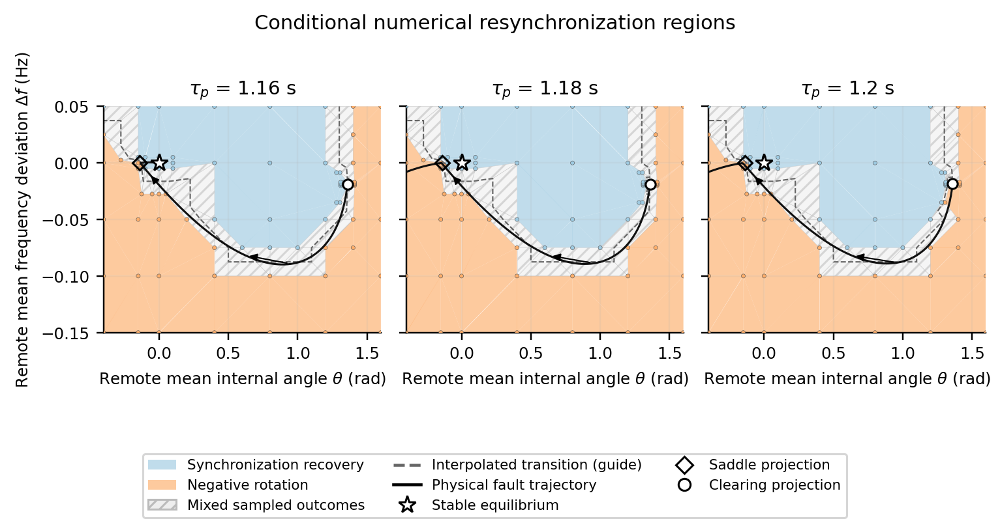
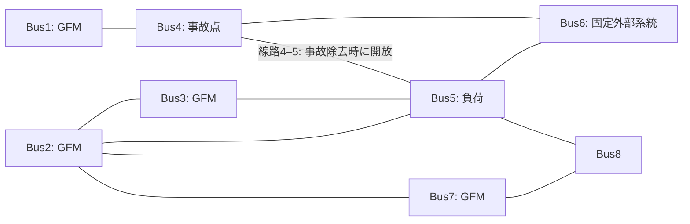

# GFMを含む電力系統の同期回復と減速脱調

事故後にGFMが同期を回復する場合と、系統の基準位相に対して遅れる方向に回転し続ける場合を比較するシミュレーションです。**局所安定な事故後平衡点が存在していても、事故後の状態からそこへ戻れるとは限らない**という例を扱います。

GFMは、交流電圧の大きさと位相を内部で生成するコンバータです。このモデルでは4台のGFMが送電線と負荷を通してつながり、Bus6の電圧・周波数を固定した外部系統に接続されています。ここでの「減速脱調」は、60 Hzの基準に対する位相の遅れが負方向の複数回転として進行することを指します。

**図と結果は保存済みなので、このページを見るだけなら計算環境の準備は不要です。** 再作図にはPython、モデルの再計算にはJuliaを使います。

## 1. 最初に見る結果

### 時系列：回復する条件と減速する条件


[PDFを見る](docs/figures/tau_comparison.pdf)

横軸は**事故除去後の時間[s]**です。上段は遠方GFM群（Bus2・3・7）の平均内部位相が事故除去時から何回転変わったか、下段は同群の平均内部周波数が60 Hzから何Hzずれているかを示します。負方向の回転数が増え続ける線が減速脱調の例です。回復した線も、事故除去時の位相に戻る必要はありません。

| 全4台の有効電力フィルタ時定数τp | 観測時間 | 遠方平均内部位相の変化 | 観測区間での結果 |
|---:|---:|---:|---|
| 1.16秒 | 300秒 | −0.21635回転 | 同期回復 |
| 1.18秒 | 300秒 | −41.66666回転 | 負方向回転が継続 |
| 1.20秒 | 1000秒 | −164.39928回転 | 負方向回転が継続 |

### 状態空間：どの初期状態から回復したか



[比較図PDF](results/conditional_basins/figures/conditional_basins_comparison.pdf) ／ [平衡点・事故除去点付近の拡大PDF](results/conditional_basins/figures/conditional_basins_zoom.pdf)

各パネルはτpの異なる条件です。**横軸θは遠方平均内部位相[rad]（事故後安定平衡点を0）、縦軸Δfは遠方平均内部周波数偏差[Hz]（60 Hzを0）**です。時系列図とは位相の原点・単位が異なります。

| 図の色・記号 | 意味 |
|---|---|
| 青 | この初期状態から計算すると、有限観測時間の回復基準を満たした |
| 橙 | 負方向回転の継続基準を満たした |
| 小さい点 | 詳細モデルを実際に計算した初期状態 |
| 斜線 | 三角形の頂点で結果が異なる。内部の分類は確定していない |
| 破線 | 計算点の分類を補間した遷移の目安 |
| 星 | 局所安定平衡点：近くの状態からは戻る定常状態 |
| ひし形 | 鞍点の投影：一部の方向へ離れる性質を持つ不安定平衡点 |
| 白丸 | 実事故の除去状態を2軸に投影した点 |
| 黒線・矢印 | 実事故後の軌道と、その時間方向 |

このモデルには**52個の微分状態**があります。上の背景では、遠方3台の内部角とPフィルタ状態を同じ量ずつ変更し、機間差と残り46状態の**初期値**を平衡点にそろえています。初期化後は全52状態を時間積分した、**条件付きの数値回復領域**です。各τで88点、計264点を使っています。実事故の除去状態やその後の軌道は、この初期状態の断面から外れ得ます。実事故応答の分類は、背景の色とは別に全モデルの時間積分で確認しています。

同じ色の頂点を持つ三角形も、その内部全点を計算したわけではありません。破線は厳密な吸引域境界ではありません。

### ほかに確認できる図

- [各GFMの位相・周波数・電圧・有効電力（τp=1.20秒）](results/conditional_basins/figures/each_gfm_tau1.20.pdf)：平均だけでなく各機の応答を確認できます。横軸は事故除去後時間[s]、縦軸は順に内部位相変化[回転]、内部周波数偏差[Hz]、端子電圧[pu]、コンデンサ側有効電力[pu]です。
- [同じ2座標で残りの状態を変えた比較](results/conditional_basins/figures/hidden_state_sensitivity.pdf)：横軸は初期化からの時間[s]、縦軸は安定平衡点基準の平均内部位相[回転]です。最初100秒を表示し、分類は双方1000秒で確認しています。同じ角度・周波数でも結果が変わる例です。
- [保存結果一覧](results/conditional_basins/README.md)：3条件それぞれの図、数値表、初期状態、数値精度の確認結果をまとめています。

## 2. 何を模擬しているか

事故前は線路4–5がつながっています。絶対時刻1.0秒にBus4の20 pu受動シャント事故を投入し、0.15秒後にシャントを除去すると同時に線路4–5を開放します。線路内短絡の両端遮断とは異なる操作です。



接続関係を示す模式図です。線の長さはインピーダンスの大きさを表しません。

| 項目 | 設定 |
|---|---|
| GFM／固定スラック | Bus1・2・3・7／Bus6、60 Hz |
| 遠方群の平均 | Bus2・3・7の等重み平均 |
| モデル | 52微分状態＋14代数変数の詳細DAEモデル |
| 系統係数k | 1.02990。線路4–6・5–6のRとXを既存の方法で変更する倍率。SCRそのものではない |
| Bus5負荷 | 定コンダクタンス負荷、倍率2.461761102780045。実消費電力は電圧でも変わる |
| P指令 | Bus1・2・3・7順に[0.5,0.4,0.4,0.4] pu。コンデンサ側測定電力に対応 |
| 時定数 | 全台τp=1.16／1.18／1.20秒、全台τq=0.02秒 |
| 内側制御 | 修正済みフィードフォワード、既存PIゲイン、電流指令制限1.2 pu |

Kpはドループゲイン、τpは有効電力測定フィルタの時定数です。別のパラメータです。内部位相と端子電圧位相、コンデンサ側電力と端子側電力も区別して保存しています。

3条件の事故後平衡点の位置は同じで、安定点と鞍点の遠方平均内部角間隔は約0.139445 rad（約7.99度）です。τpを変えると動特性が変わります。平衡点の位置だけでは事故後応答を判断できません。

## 3. 保存結果だけを再作図する

以下はすべてリポジトリ直下で実行します。この手順ではJuliaも新しいシミュレーションも不要です。

```bash
git clone https://github.com/hashima0205/gfm-deceleration-separated-equilibria.git
cd gfm-deceleration-separated-equilibria
python -m venv .venv
. .venv/bin/activate
python -m pip install -r code/requirements.txt
python code/check_saved_basins.py
python code/plot_saved_basins.py
```

`figures/saved_results/conditional_basins/` にPDF・PNGが作られます。保存済みの計算点・三角形・時系列を使い、元の結果は上書きしません。[列名・単位・平均方法](results/conditional_basins/DATA_DICTIONARY.md)も参照してください。

## 4. シミュレーションを再計算する

Julia 1.12.5、Python 3.12で確認しています。Juliaの依存環境を準備します。

```bash
julia --project=provenance -e 'using Pkg; Pkg.instantiate()'
mkdir -p logs
```

まず事故除去後30秒の動作確認を行います。30秒だけでは持続脱調を判定しません。

```bash
julia --history-file=no --project=provenance code/run.jl smoke.csv > logs/smoke.log 2>&1
python code/check_reference.py --smoke
```

主ケース（τp=1.20秒）を1000秒まで計算する場合：

```bash
julia --history-file=no --project=provenance code/run.jl representative.csv > logs/representative.log 2>&1
python code/check_reference.py
python code/summarize.py
python code/plot_results.py
```

3条件を比較する場合は `representative.csv` を `demo.csv` に変更します。引き込み領域の代表2点だけを再計算する場合は、次を使います。

```bash
julia --history-file=no --project=provenance code/run_basin.jl refine_00247 focus_00148
```

この2点は保存結果で回復／負方向回転に分かれた初期状態です。全点の再計算は[引き込み領域の計算方法](docs/SAVED_BASINS.md)を参照してください。保存済みの背景を確認するだけなら再計算は不要です。

## 5. パラメータを変える・コードを読む

例：時定数を1.20秒に保ち、事故時間を0.10秒にするCSVを `data/my_cases.csv` として保存します。この行は変更方法の例で、上の図はT=0.15秒の結果です。

```csv
case,op,load_scale,P1,P2,P3,P7,taup,tauq,T,horizon,level
my_tau120_T010,nf02_1,2.461761102780045,0.5,0.4,0.4,0.4,1.2,0.02,0.10,300,A
```

`julia --project=provenance code/run.jl my_cases.csv` で実行します。τp、事故時間T、観測時間horizon、精度levelを変更できます。**条件やコードを変えたらcase名も変えてください。** k、負荷、指令などの変更には対応する平衡点の再準備が必要です。[CSV全列の説明・精度・再開方法](docs/RUNNING.md)に詳しく記載しています。

| 場所 | 役割 |
|---|---|
| [code/run.jl](code/run.jl) | 実事故シナリオの計算入口 |
| [code/run_basin.jl](code/run_basin.jl) | 保存された引き込み領域の初期状態を再計算 |
| [code/plot_saved_basins.py](code/plot_saved_basins.py) | 保存結果から領域図・時系列・各機応答を再作図 |
| [code/check_saved_basins.py](code/check_saved_basins.py) | 計算点・初期状態・分類・時系列・ハッシュの整合性確認 |
| [code/engine12.jl](code/engine12.jl) | ソルバ、事故切替、代数再初期化、電力・電流の観測 |
| [code/classify.py](code/classify.py) | 有限観測時間での回復・回転の分類 |
| [results/conditional_basins](results/conditional_basins/README.md) | 既存281条件の結果・264点の背景・図・作図データ |
| [provenance](provenance) | 固定したJulia環境とモデル本体 |
| [tests/reference](tests/reference) | 実事故再計算の参照値 |

## 6. この結果から言える範囲

保存図の背景は指定した初期状態断面に対する有限時間の分類です。全52次元の吸引域や、無限時間続く回転を証明したものではありません。「回復」は位相・周波数の基準による判定で、全PI積分状態まで完全収束したことを保証しません。

今回のτp≈1.2秒は大きい設定です。運転点は追跡した正常枝の合流負荷から0.1%下にあり、角度間隔だけで電圧安定余裕は決まりません。実機一般の動作範囲、EMT/PWM、DC側・保護動作まで確認した結果ではありません。[数値検証の記録](docs/VALIDATION.md)と[保存結果の出典・方法](docs/SAVED_BASINS.md)を併読してください。
