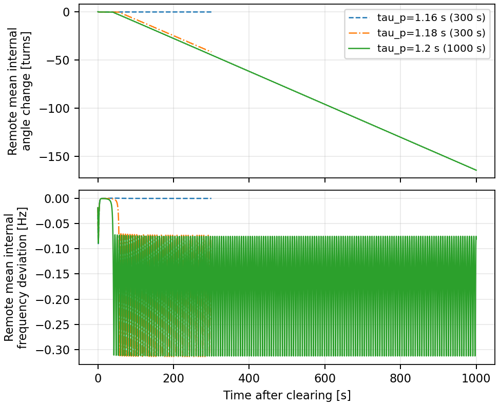

# 安定平衡点と鞍点の間隔がある条件の減速脱調

このリポジトリは、研究31の `nf02_1` 条件を再現します。主ケースは**全GFMの有効電力フィルタ時定数τp=1.20秒、事故時間T=0.15秒**です。局所安定な事故後平衡点が存在し、遠方GFM群が事故除去後1000秒まで負方向に回転した保存結果に対応します。同じ負荷・指令でτp=1.16秒の回復例、1.18秒の減速例も計算できます。

共有用コードから3条件を再計算し、元の全状態・回転数・分類との一致、集計・作図まで確認しました。[共有版の検証記録](docs/VALIDATION.md)を参照してください。



図の横軸は事故除去後時間[s]、上段は遠方平均内部角変化[回転]、下段は遠方平均内部周波数偏差[Hz]です。[PDF版](docs/figures/tau_comparison.pdf)も同梱しています。

## 1. 設定と既存の参照値

| 項目 | 値 |
|---|---|
| GFM／固定スラック | Bus1・2・3・7／Bus6、60 Hz |
| 遠方群 | Bus2・3・7の等重み平均 |
| 状態数 | 52微分状態＋14代数変数 |
| 系統係数 | k=1.02990、線路4–6・5–6の既存R/X変更方法。SCRそのものではない |
| Bus5定コンダクタンス倍率 | 2.461761102780045。消費電力倍率ではない |
| 有効電力指令 | Bus1・2・3・7順に[0.5,0.4,0.4,0.4] pu、コンデンサ側測定 |
| 有効電力フィルタτp | 全4台共通で1.16／1.18／1.20秒 |
| 無効電力フィルタτq | 全4台0.02秒 |
| Kp | 7.5398223686155035。ドループゲインであり時定数ではない |
| 事故 | 絶対時刻1.0秒にBus4へ20 pu受動シャントを投入 |
| 事故除去 | 絶対時刻1.15秒にシャント除去と線路4–5開放。線路内事故の両端遮断ではない |
| 内側制御 | 修正済みVC_F=CC1_F=1、既存PIゲイン、電流制限1.2 pu |

| τp [s] | 観測時間 [s] | 遠方平均内部角変化 [回転] | 有限時間の分類 |
|---:|---:|---:|---|
| 1.16 | 300 | −0.216354594663 | 回復 |
| 1.18 | 300 | −41.666656611154 | 負方向回転継続 |
| 1.20 | 1000 | −164.399278475694 | 負方向回転継続 |

事故後安定根と鞍点の遠方平均内部角間隔は0.139444735864 rad（約7.99度）。τp=1.20秒で安定根の最大固有値実部は−0.001832429788 s⁻¹、鞍点は+0.083399435467 s⁻¹で不安定モード1個。完全DAE残差はそれぞれ7.46e−12、6.07e−12です。

この角度間隔は52次元の吸引域の大きさや電圧崩壊余裕ではありません。運転点は追跡した正常枝の合流負荷から0.1%下です。τp≈1.2秒は大きい設定であり、一般的な小さいτpやEMT/PWM・実機での検証とは区別します。

## 2. 実行方法

以下のコマンドは**リポジトリ直下**で実行します。Julia 1.12.5とPython 3.12を確認対象としています。依存環境と必要なモデルは同梱しています。

```bash
git clone https://github.com/hashima0205/gfm-deceleration-separated-equilibria.git
cd gfm-deceleration-separated-equilibria
julia --project=provenance -e 'using Pkg; Pkg.instantiate()'
python -m venv .venv
. .venv/bin/activate
python -m pip install -r code/requirements.txt
```

最初は30秒の動作確認を行います。この段階だけで持続脱調を判定しないでください。

```bash
mkdir -p logs
julia --history-file=no --project=provenance code/run.jl smoke.csv \
  > logs/smoke.log 2>&1
python code/check_reference.py --smoke
python code/summarize.py
python code/plot_results.py
```

主ケースだけを1000秒まで計算する場合：

```bash
julia --history-file=no --project=provenance code/run.jl representative.csv \
  > logs/representative.log 2>&1
python code/check_reference.py
python code/summarize.py
python code/plot_results.py
```

回復・減速の3条件を比較する場合：

```bash
julia --history-file=no --project=provenance code/run.jl demo.csv \
  > logs/demo.log 2>&1
python code/check_reference.py --all
python code/summarize.py
python code/plot_results.py
```

`representative.csv` と `demo.csv` のτp=1.20秒は同じ条件・名前なので完了済み区間を再利用します。許容誤差を厳しくした1000秒比較は `strict.csv` を指定します。Julia起動・モデル構築に数分かかることがあります。出力はこのリポジトリ内に保存されます。

## 3. パラメータ変更

`data/my_cases.csv` に次の12列の順で記述し、`run.jl my_cases.csv` と実行します。

```csv
case,op,load_scale,P1,P2,P3,P7,taup,tauq,T,horizon,level
my_tau120_T010,nf02_1,2.461761102780045,0.5,0.4,0.4,0.4,1.2,0.02,0.10,300,A
```

| 列 | 意味・変更方法 |
|---|---|
| case | 保存名。条件やコードを変更したら新しい名前を使う |
| op | 平衡点シードの識別子。この入口では `nf02_1` に固定 |
| load_scale | Bus5負荷コンダクタンス倍率。この入口では上表の値に固定 |
| P1,P2,P3,P7 | 各GFMのP指令[pu]。この入口では[.5,.4,.4,.4]に固定 |
| taup | 全4台の有効電力フィルタ時定数[秒]。正の値を指定 |
| tauq | 全4台の無効電力フィルタ時定数[秒]。この入口では0.02に固定 |
| T | 事故継続時間[秒]。投入は1.0秒、除去は1.0+T秒 |
| horizon | 事故除去後の観測時間[秒]。正の整数 |
| level | `A`：reltol=1e−9、abstol=1e−11、dtmax=.005秒。`B`：1e−10、1e−12、.0025秒 |

ソルバはRodas5P。保存刻みは事故前.01秒、事故中.0005秒、事故後.02秒、各区間先頭20msは.0001秒です。保存刻みと積分精度は別の設定です。CSVにコメント・空行・引用符付きカンマは入れません。

**k、負荷、P/Q指令、ゲイン、τqなどを変える場合は、その条件の平衡点を解き直す準備が必要です。** この専用入口は負荷・P指令などの誤変更を拒否します。τpとTの変更でも各条件の事故前安定平衡点から計算し、保存根の残差・局所安定性を再検証します。旧事故除去状態は流用しません。

完了した区間はチェックポイントから再開できます。CSV行・実行コード・モデルのハッシュが変わった場合は同じcaseの再利用を拒否します。観測時間だけ変える場合も新しいcase名を使ってください。この入口では、区間の重複を避けるため同じcase名での時間延長を行いません。

## 4. コードと出力

| ファイル | 内容 |
|---|---|
| code/run.jl | CSV検査、全台のパラメータ設定、根の検証、事故前・中・後の積分 |
| code/model.jl | 共通の系統モデルを読み込む。単独実行は不要 |
| code/engine12.jl | 元研究と同じ事故切替・全52微分状態の保持・14代数変数の整合化・観測・ソルバ |
| code/observations12.py | 保存時系列の結合、各機の端子位相unwrap、平均量の計算 |
| code/classify.py | 各機の末尾位相・周波数と複数窓の進行量による有限時間分類 |
| code/summarize.py | 計算結果をdata/summary.csv、machines.csvへ集計 |
| code/check_reference.py | 元研究の事故前・除去時・終端の全66状態と比較し、全台τp/τq・指令・FFを確認 |
| code/plot_results.py | 保存された全サンプルから比較図・各機応答図を作成 |
| data/seeds/nf02_1_pre*.csv,post*.csv | 各条件で残差・固有値を再確認する事故前後の定常候補 |
| tests/reference/ | 元研究の小さな参照終端状態、分類・平衡点・精度比較表 |
| provenance.json | 元コード・入力のパスとSHA-256。共有用変更はGit履歴で追跡 |
| provenance/MODEL_SHA256SUMS | 同梱モデル・Julia依存環境のSHA-256。リポジトリ直下で `sha256sum -c provenance/MODEL_SHA256SUMS` により確認 |
| checkpoints/CASE/ | 生の時系列、全状態、パラメータ、終了状態・ソルバ情報 |
| data/parameter_audit.csv | pre/fault/postの各台τp・τq・P/Q指令・FF |
| data/equilibria.csv | 各定常候補の完全残差、最大固有値実部、不安定モード数 |
| figures/ | tau_comparison.pdf/png、各機応答のPDF/PNG |

生成される大容量時系列・チェックポイントはGit管理対象から除外しています。`provenance.json` のSHA-256はコピー元の特定情報です。共有用のパス変更や実行検査追加後のコードはGitコミットで特定してください。

## 5. 図の軸・判定

比較図の横軸は事故除去後時間[s]。上段は遠方3台の平均内部角の除去時からの変化[回転]、下段は平均内部周波数偏差[Hz]です。固定スラック60Hz同期座標で、Bus1基準ではありません。内部角と端子電圧位相は別量です。各機図は内部角変化、内部周波数、端子電圧、コンデンサ側Pを表示します。Pの細い水平点線は指令値です。

`recovery` は末尾の各機最大|Δf|<1e−4 Hz、角変動幅<.005 rad、安定根との角誤差<min(.002 rad,安定根–鞍点の各機角差×.1)。`negative_running` は負方向2回転超に加え、観測後半60%を3分した全窓で−.2回転超、平均回転速度<−1e−4回転/秒を要求します。単なる負方向変位を持続脱調とは分類しません。全52状態の完全収束や無限時間の持続を証明する判定ではありません。

**30秒のsmokeは実装の照合用です。主張に使う観測時間はケース表を確認してください。** 事故前・事故後の根を含む起動時ログには共通モデルの基準根も表示されるため、今回の根の判定にはdata/equilibria.csvのcase別行を使います。
