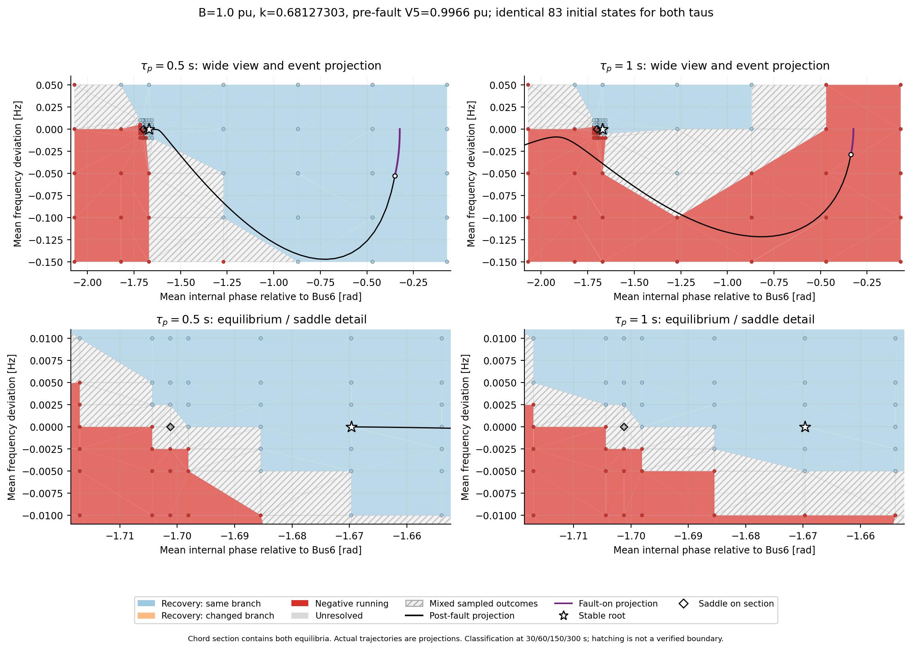
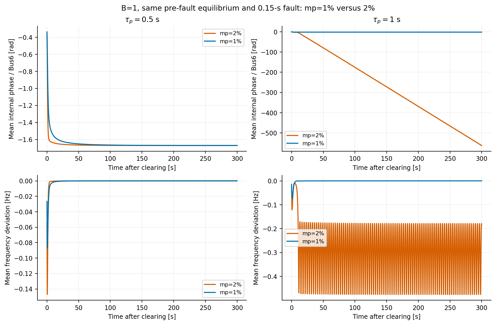
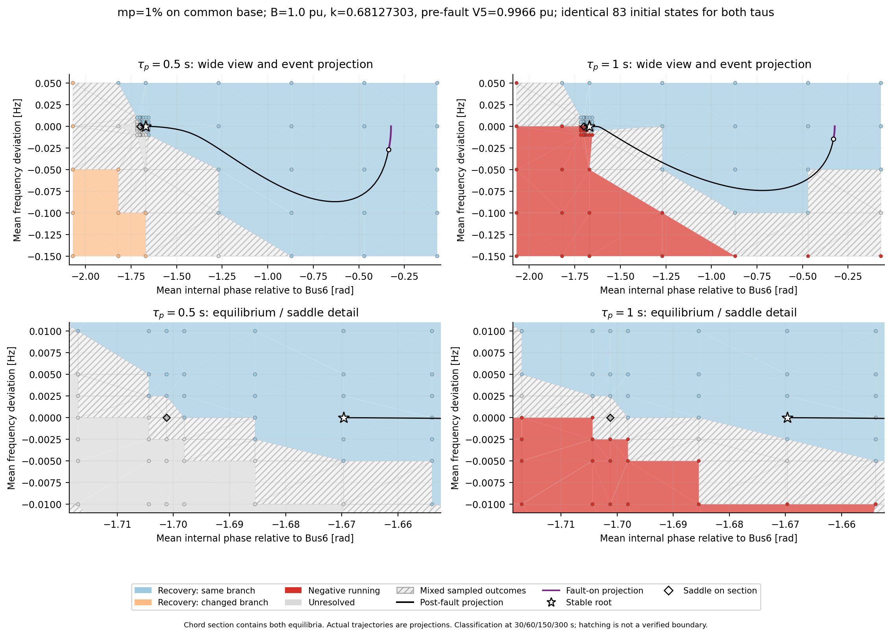
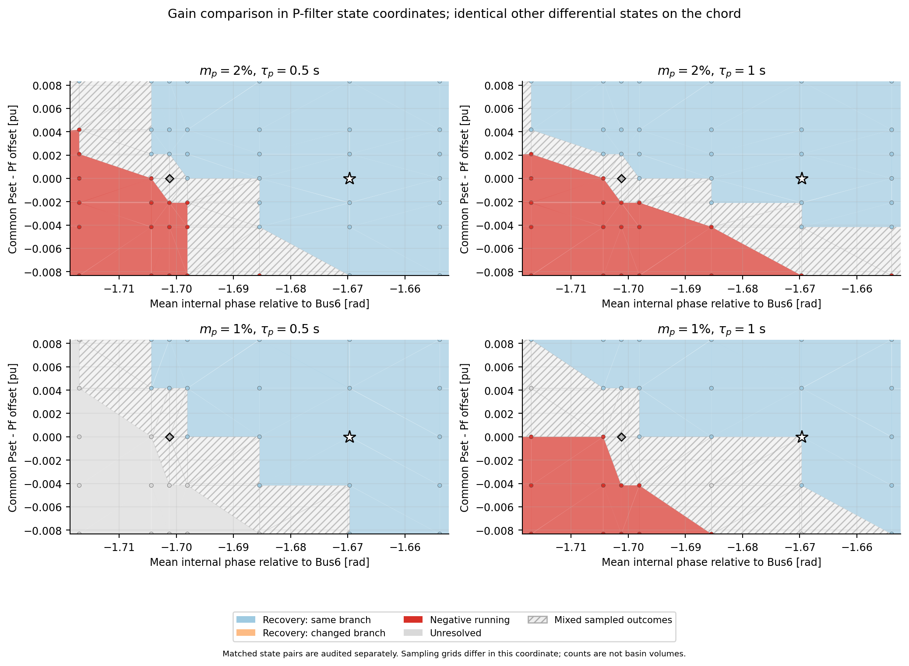

# コンデンサによる電圧調整後

<!-- B100-current:start -->
## B=1.0、ドループ2%でのτp=0.5秒と1.0秒

k=0.6812730259、補償B=1.0 pu。事故前の負荷端電圧0.99659 pu、事故後安定点0.85708 pu。対応する定常枝の折返しk≈0.68134116の0.01%手前を使用。事故前電圧は1 puに近いが、系統条件はなお平衡点消失の限界に近い。

[領域図PDF](07_basins_B100_tau050_tau100.pdf) ／ [事故応答の時系列](08_trajectories_B100_tau050_tau100.png) ／ [系統図](equilibrium_network_B100.png) ／ [分類・監査要約](B100_tau_comparison_validation.json)

| τp [s] | 回復：参照枝 | 回復：異なる位相枝 | 負方向回転 | 未確定 | 今回の実事故 |
|---|---:|---:|---:|---:|---|
| 0.5 | 52 | 0 | 30 | 0 | 回復 |
| 1 | 36 | 0 | 46 | 0 | 減速方向の持続回転 |

各τに鞍点そのものの初期値を別に1点含む。上段は広域格子、下段は平衡点・鞍点の近傍を細分した表示。両τで全66状態が同一の83初期値を使用した。52微分状態は安定点と鞍点を通る弦で変化させ、遠方3台の周波数を共通にずらす。広域には弦の外挿を含む。代数整合化後は全状態を積分し、30→60→150→300秒の段階分類を行った。

斜線は頂点の分類が混在する三角形で、境界の厳密な位置を表さない。分類点は非一様に配置しており、点数比を引き込み領域の面積比とは解釈しない。実事故軌道は断面外の投影。事故軌道が回復色の上に見えることだけでは、回復の可否は決まらない。

事故操作はBus4の20 puシャント事故0.15秒、除去時に線路4–5開放。P指令[0.5,0.4,0.4,0.4] pu、負荷G=2.2682301152 pu、τq=0.02秒を共通にした。事故前の負荷Pは約2.25281 pu、補償Qは約0.99320 pu。Bの妥当性を電圧だけで判断した試験ではなく、今回は電圧を1 pu近傍にした設定でτを比較した。

再計算：`JULIA_NUM_THREADS=1 OPENBLAS_NUM_THREADS=1 julia --project=provenance code/run_B100_tau_comparison.jl`。監査・再作図：`MPLCONFIGDIR=/tmp/gfm-matplotlib .venv/bin/python code/check_plot_B100_tau_comparison.py`。生データは`basin_recalculation/B100_tau_comparison/`。各条件でJuliaを再起動せず、1プロセスで処理する。

## ドループ1%と2%の比較（同じB=1.0、k）

1%・2%は共通電力ベースに対する値で、インバータ定格ベースとの一致は仮定していない。全4台のKpだけを7.53982237から3.76991118 rad/s/puへ半減した。事故前・事故後の平衡点は共通。事故操作も同一で、300秒の応答を比較した。

τp=0.5秒では両ゲインで回復。τp=1.0秒では2%が減速方向に持続回転する一方、1%は回復した。

位相・周波数を同じ格子にすると、Kpが異なるため初期Pfは一致しない。図11では縦軸を共通のPset−Pfに変更した。格子の範囲・密度はこの座標では異なるので、同一の全66状態を持つ点の組も別途照合した。事故軌道は断面への投影である。

| τp [s] | 1%：参照枝回復 | 1%：別枝回復 | 1%：負方向回転 | 1%：未確定 | 全状態が一致する比較点数 |
|---|---:|---:|---:|---:|---:|
| 0.5 | 50 | 10 | 0 | 22 | 48 |
| 1 | 43 | 0 | 35 | 4 | 48 |

各τ83点（鞍点そのもの1点を含む）。未確定は300秒以内に判定基準を満たさなかった点で、脱調とは区別する。点数は領域の面積・体積を表さない。

同じ全66状態の48点ずつを比較したところ、τp=1.0秒で2%が負方向回転した25点は、1%で7点回復、16点負方向回転、2点未確定になった。τp=0.5秒で2%が負方向回転した17点は、1%で3点が別位相枝へ回復、14点が未確定。したがって、改善例は確認できるが、未確定点を含めた領域全体の包含関係までは確定していない。

電圧一定・非飽和の単純化では、τ δ̈+δ̇=Kp(Pset−P(δ))。小振幅の固有角周波数は√(Kp P′/τ)、減衰比は1/(2√(τ Kp P′))。Kpを下げる場合とτを上げる場合はともに応答を遅くするが、減衰比への作用は逆向き。この近似だけから多次元の引き込み領域の単調性までは決められない。

[監査結果](B100_Kp01_tau_comparison_validation.json) ／ [全状態が一致する点の分類比較](B100_Kp01_matched_full_state_comparison.csv) ／ [事故応答PDF](12_trajectories_B100_Kp_comparison.pdf)

再計算：`julia --project=provenance code/run_B100_Kp01.jl`（全条件を1プロセスで実行）。監査・再作図：`MPLCONFIGDIR=/tmp/gfm-matplotlib .venv/bin/python code/check_plot_B100_Kp01.py`。生データ：`basin_recalculation/B100_Kp01_tau_comparison/`。

## 以前の比較条件（B≈0.55618）
<!-- B100-current:end -->

元のk=1.0299の代表例：事故前Bus5電圧0.95000 pu、並列B=0.55618062 pu。コンデンサは事故前・中・後すべて接続。負荷G・GFMのP指令・線路・事故操作は元の設定と共通。事故前の負荷Pは1.85217→2.04707 pu、コンデンサ供給Qは0.50195 pu。

- [02_trajectories_tau010_tau120](02_trajectories_tau010_tau120.png)（[PDF](02_trajectories_tau010_tau120.pdf)）：代表例だけの位相平面・位相時系列・周波数時系列。τp=0.1秒・1.2秒を比較。破線は事故中、丸は除去時。

元のk=1.0299では事故後安定平衡点が未確認。kを下げた条件の平衡点・引き込み領域は下の別節に記す。事故中・事故後の軌道は両τで計算済み。

位相はBus6基準。電圧だけでなく負荷Pも増えており、電圧だけの効果は切り分けていない。

## 引き込み領域の計算状況（元のk=1.0299）

| τp [s] | 事故後安定平衡点 | 平衡点基準の引き込み領域 | 事故中軌道 | 事故後軌道 |
|---|---|---|---|---|
| 0.1 | 再探索でも未発見 | 基準安定点がなく未計算 | 計算済み：0.15秒 | 計算済み：150秒 |
| 1.2 | 再探索でも未発見 | 基準安定点がなく未計算 | 計算済み：0.15秒 | 計算済み：150秒 |

対象は代表例（事故前V5=0.95 pu、B=0.55618062 pu）。平衡点の位置はτpに依存しないため、定常方程式の探索は両τで共通。安定性と引き込み領域はτに依存する。

- [03_postfault_equilibrium_search](03_postfault_equilibrium_search.png)（[PDF](03_postfault_equilibrium_search.pdf)）：元の2平衡点の枝の追跡と、現在のBにおける多初期値探索。

既知の全状態モデルの6平衡点と照合した定常方程式（最大残差4.11e-14）を使用。642初期値から探索し、現在のBでは平衡点候補0個。元の安定点と鞍点につながる枝の局所的な折返しはB=0.004281335 pu。現在のBはこれより大幅に大きい。

全平衡点の不存在を証明したものではない。回復先が確認できないため、領域を回復色で塗る計算は実施していない。探索データは`basin_recalculation/capacitor_equilibrium_search/`、要約はこのフォルダの`equilibrium_search_status.json`。現条件で引き込み領域の計算が完了したという扱いにはしない。

## kを下げて系統を強めた比較

コンデンサB=0.55618062 pu、負荷G=2.2682301152 pu、GFMのP指令と事故操作を維持し、線路4–6・5–6のR/Xだけを変更。事故前電圧を再び0.95 puへ合わせ直す操作はしていない。

| k | 事故前V5 [pu] | 事故後安定点V5 [pu] | τp=0.1秒の実事故 | τp=1.2秒の実事故 |
|---:|---:|---:|---|---|
| 0.8 | 0.95498 | 0.84760 | 回復 | 減速方向の持続回転 |
| 0.75 | 0.95623 | 0.87471 | 回復 | 回復 |
| 0.7 | 0.95756 | 0.88938 | 回復 | 回復 |

- [04_stronger_grid_trajectories](04_stronger_grid_trajectories.png)（[PDF](04_stronger_grid_trajectories.pdf)）：k=0.80・0.75・0.70の実事故応答。事故中から事故後150秒まで計算。

全状態モデルで各k・両τの事故前安定点・事故後安定点・鞍点を確認。独立の定常方程式とも照合した。元のk=1.0299で平衡点未発見という上の結果とは条件を区別する。

定常枝の折返しはk≈0.807313。k=0.80はこの境界より約0.9%小さく、なお限界に近い設定である。事故前電圧0.95 pu以上でも安定平衡点と減速脱調が共存する例にはなったが、広い運転範囲で起こることを示したものではない。

- [05_basin_k080_tau010](05_basin_k080_tau010.png)（[PDF](05_basin_k080_tau010.pdf)）：k=0.80、τp=0.1秒の引き込み領域と事故中・事故後軌道。55点。

- [05_basin_k080_tau120](05_basin_k080_tau120.png)（[PDF](05_basin_k080_tau120.pdf)）：k=0.80、τp=1.2秒の引き込み領域と事故中・事故後軌道。55点。

両τで全66状態が同一の初期値55点を使用。52微分状態を安定点と鞍点の弦で変化させ、遠方3台の周波数を共通にずらした後、14代数変数を整合化する。両平衡点そのものを含む。事故軌道はこの断面外への投影であり、投影が回復色の上にあってもその色から実事故の回復は判定しない。分類は30秒、未確定のみ60・150秒へ延長する有限時間の格子計算。

再計算：`julia --project=provenance code/run_capacitor_k_strength.jl`（1プロセス）。監査・再作図：`MPLCONFIGDIR=/tmp/gfm-matplotlib .venv/bin/python code/check_plot_capacitor_k_strength.py`。生データは`basin_recalculation/capacitor_k_strength/`、数値表と監査要約はこのフォルダに保存。

## τp=0.1秒の追加探索

- [06_fast_tau_search](06_fast_tau_search.png)（[PDF](06_fast_tau_search.pdf)）：kを折返しへ近づける探索、補償シャントBの変更、事故シャント強度の変更を集約。
- [探索した25条件の数値](fast_tau_search_results.csv) ／ [検証要約](fast_tau_search_validation.json)

固定G・P指令のまま、B=0.55618でk=0.804～0.80731の6条件、B=0.8・1.0・1.2で各折返しの1%・0.1%・0.01%手前の9条件、事故シャント強度2・5・10・40・80 puの追加10条件を確認した。事故時間はすべて0.15秒。事故前負荷端電圧は0.9548～1.0159 pu、各条件の事故前・事故後平衡点は全状態モデルで局所安定だった。

25条件すべて回復。必要に応じて30→60→150→300秒へ延長したが、この範囲ではτp=0.1秒の持続する減速脱調は未発見。一般的な不存在を示した結果ではない。元のk=0.80・τp=1.2秒の減速脱調例は引き続き成立する。

再現：`code/prepare_fast_tau_search.py`で条件を準備し、`basin_recalculation/fast_tau_search/finish.flag`を置いてから`julia --project=provenance code/run_fast_tau_search.jl`を実行する。モデル構築は1回。finish.flagがない場合は条件CSVへの追加を待つため、同じプロセスに追加条件を投入できる。監査・再作図は`MPLCONFIGDIR=/tmp/gfm-matplotlib .venv/bin/python code/check_plot_fast_tau_search.py`。
