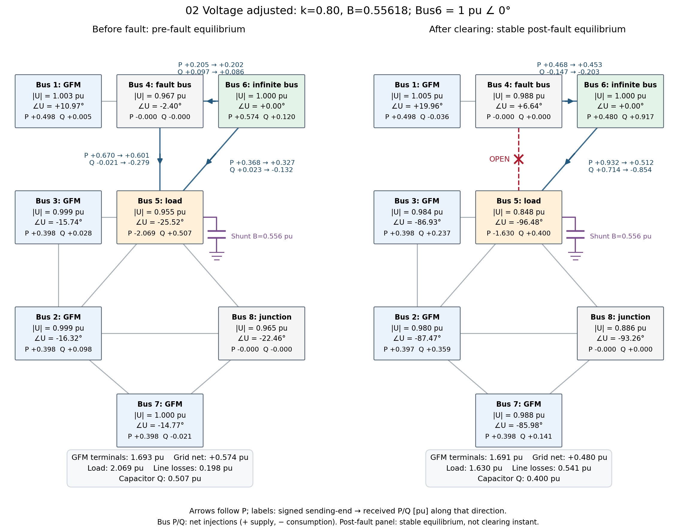
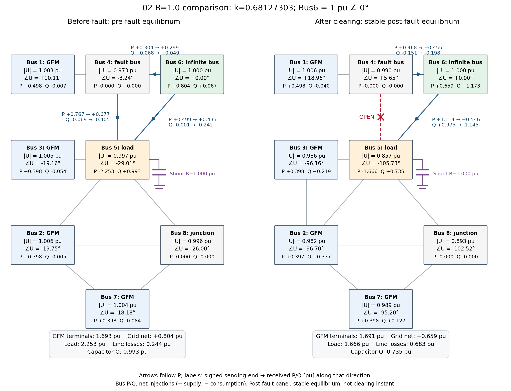

# 検討別の図

| フォルダ | 条件 | 主に見る図 |
|---|---|---|
| [01_original](01_original/README.md) | 元の設定、コンデンサなし、事故前V5=0.90364 pu | 引き込み領域＋事故軌道、τの異なる実事故応答 |
| [02_voltage_adjusted](02_voltage_adjusted/README.md) | 今回：B=1.0、k=0.681273、事故前V5≈0.997 pu（以前の条件も併記） | τp=0.5／1.0秒の引き込み領域と事故軌道 |

最新の比較：[ドループ1%と2%の事故応答](02_voltage_adjusted/12_trajectories_B100_Kp_comparison.png) ／ [共通状態座標の引き込み領域](02_voltage_adjusted/11_basins_B100_Kp_state_comparison.png)。

図の位相・周波数は遠方3台（Bus2・3・7）の平均内部量。位相はBus6基準。引き込み領域と事故中・事故後の実軌道を中心に表示する。

trajectory_neighborhoodは一覧から外し、図と数値を`basin_recalculation/figure_archive_trajectory_neighborhood/`へ保管した。生計算は保持している。

再作図：`MPLCONFIGDIR=/tmp/gfm-matplotlib .venv/bin/python code/arrange_study_figures.py`。

従来の重複図・途中の比較図と旧レポートは`basin_recalculation/figure_archive_before_case_layout/`へ移動した。生の計算データは保持している。今後の図はこの2分類で整理する。

<!-- network-panels:start -->

## 事故前後の電圧・潮流

各バスに端子電圧の大きさ、Bus6基準の端子位相、系統へのP/Q注入を表示。P/Qとも正は供給、負は消費。矢印は主要線路のPの向きで、P/Qの数値はその向きに沿う送電端→受電端の値（符号付き）。Qが負なら矢印とは逆向きの供給を表す。

事故後パネルは事故後系統の安定平衡点。事故除去直後ではなく、τp=1.2秒で減速脱調する応答の到達点でもない。平衡点の位置は両τで共通。

### 01：元の設定

k=1.0299、補償シャントなし、負荷G=2.2682301152 pu。

[PDF](01_original/equilibrium_network.pdf) ／ [バス数値](01_original/network_data/buses.csv) ／ [全線路潮流](01_original/network_data/lines.csv)

### 02：電圧補償あり・k=0.80

B=0.55618062 pu、k=0.80、GとP指令は01と共通。事故前の負荷端電圧は約0.955 pu、事故後安定点では約0.848 pu。元のk=1.0299・B=0.55618062の条件は安定な事故後平衡点が未確認のため、この事故後パネルには使わない。

[PDF](02_voltage_adjusted/equilibrium_network.pdf) ／ [バス数値](02_voltage_adjusted/network_data/buses.csv) ／ [全線路潮流](02_voltage_adjusted/network_data/lines.csv)

再作図：`MPLCONFIGDIR=/tmp/gfm-matplotlib .venv/bin/python code/plot_case_networks.py`。

### 02：今回のB=1.0・τ比較

B=1.0 pu、k=0.68127303（対応する折返しk≈0.68134116）。事故前負荷端電圧0.99659 pu、事故後安定点0.85708 pu。τp=0.5秒と1.0秒の平衡点は共通。

[PDF](02_voltage_adjusted/equilibrium_network_B100.pdf) ／ [バス数値](02_voltage_adjusted/network_data_B100/buses.csv) ／ [全線路潮流](02_voltage_adjusted/network_data_B100/lines.csv)
<!-- network-panels:end -->
